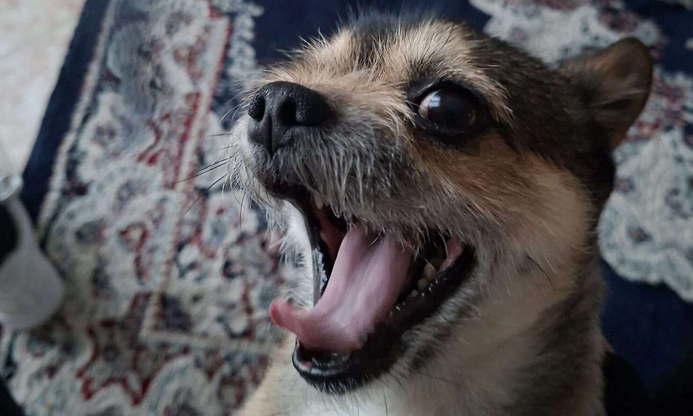

# dudas131

**Low-level developer · OSDev · Building from scratch**

---

## `about`

I'm **dudas131**, a student interested in low-level programming, operating systems, and building things from scratch.

I enjoy exploring how software works beneath the surface, experimenting with system architecture, and creating projects that push my understanding of computing.

## `projects`

<table>
<tr>
<td width="50%" valign="top">

### ⚙️ VulcanOS

My main operating system development project.

- Low-level systems programming
- OS architecture and experimentation
- Built from scratch

</td>
<td width="50%" valign="top">

### ◈ Invisible Hand

A project and experimentation space.

- Independent development
- Systems and software exploration
- Work in progress

</td>
</tr>
<tr>
<td colspan="2" valign="top">

### 🚀 Nova

A private Roblox-like platform project.

- Platform and game-development concepts
- Private development
- More to come

</td>
</tr>
</table>

## `core skills`

## `tools`

`QEMU` · `GRUB` · `LLVM` · `Clang` · `WebAssembly` · `FastAPI`

## `github activity`

---

**`C` · `C++` · `Python` · `Lua`**

*Learning how things work. Building what doesn't exist yet.*

[Discord](https://discord.gg/AuahJ9N5W) · [GitHub](https://github.com/dudas131)

